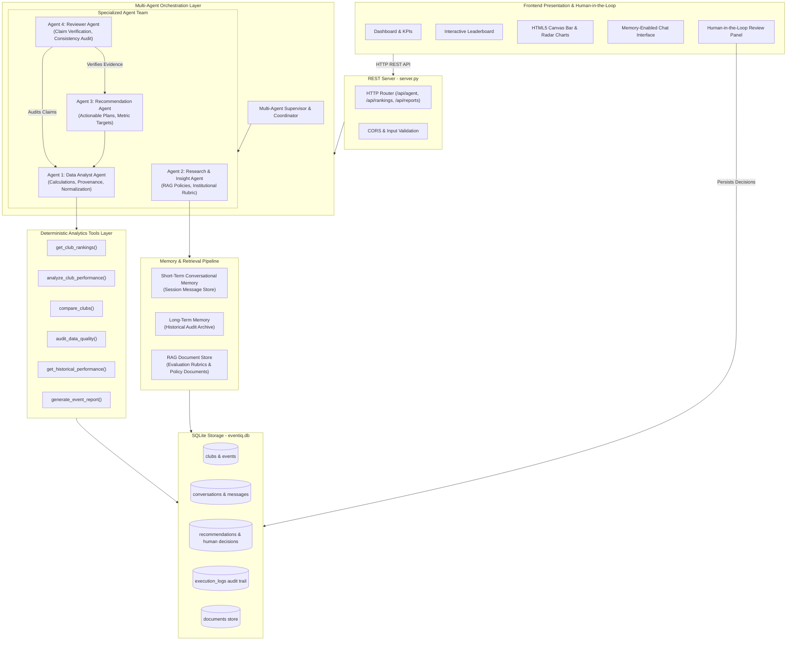
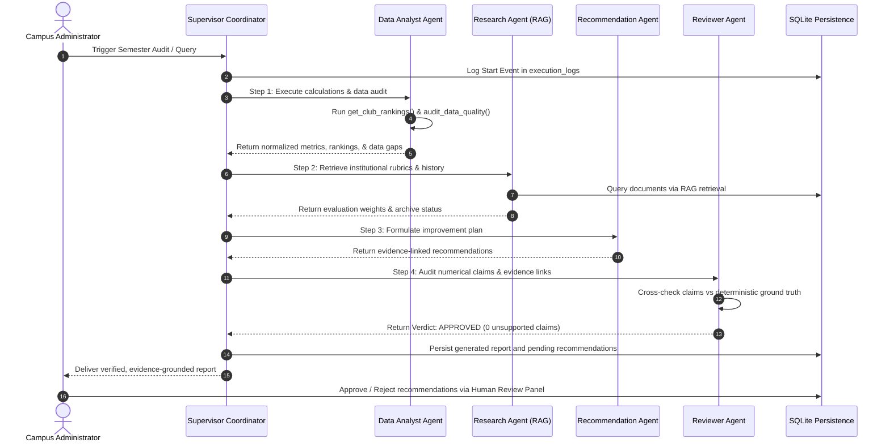

# EventIQ Agent — System Architecture & Multi-Agent Specification

**Official Project Topic:** Smart Event Analytics Agent  
**Full System Title:** EventIQ Agent — A Memory-Enabled, Tool-Using Multi-Agent System for Club Performance Analysis

---

## 1. System Overview

EventIQ Agent is an agentic, memory-enabled decision-support system designed to audit technical club operations, calculate composite performance metrics, reconcile missing records via statistical imputation, and coordinate a team of four specialized agents to generate evidence-backed institutional reports.

---

## 2. Multi-Agent Collaboration Workflow

---

## 3. Specialized Agent Roles & Responsibilities

| Agent | Core Responsibility | Available Tools | Output Schema / Invariant |
| :--- | :--- | :--- | :--- |
| **Supervisor / Coordinator** | User intent routing, step limit enforcement, state assembly. | Internal dispatch | Coordinates maximum 5 bounded steps. Terminates safely. |
| **Data Analyst Agent** | Deterministic calculations, ranking derivations, data gap audit. | `get_club_rankings`, `audit_data_quality`, `analyze_club_performance` | Never hallucinates a number. Every metric traced to database rows. |
| **Research & Insight Agent** | Institutional rubric retrieval, historical comparison checks. | `retrieve_relevant_documents`, `get_historical_performance` | Explicitly states when historical data is absent (e.g. Fall 2025). |
| **Recommendation Agent** | Practical action plans linked directly to measured weaknesses. | `analyze_club_performance` | Every recommendation must have an `evidence_metric` and measurable target. |
| **Reviewer Agent** | Independent claim auditing, contradiction detection. | Verification assertions | Verifies monotonic rank ordering and evidence bindings; issues `APPROVED` verdict. |

---

## 4. Ground-Truth Scoring Engine & Imputation Logic

### Imputation Formula for Unrecorded Turnout
$$\text{knownRate} = \frac{\sum \text{Recorded Attendance}}{\sum \text{Registrations for Events with Known Attendance}}$$
$$\text{Imputed Attendance} = \text{round}(\text{registrations} \times \text{knownRate})$$
*(Documented Fallback: 80% if a club has zero recorded events).*

### Composite Score Formula
$$\text{Composite Score} = 0.30 \cdot \text{AttRate}_{\text{norm}} + 0.30 \cdot \text{Feedback}_{\text{norm}} + 0.15 \cdot \text{Speaker}_{\text{norm}} + 0.15 \cdot \text{Consistency}_{\text{norm}} + 0.10 \cdot \text{Events}_{\text{norm}}$$
All normalized components strictly bounded to $[0, 100]$.
